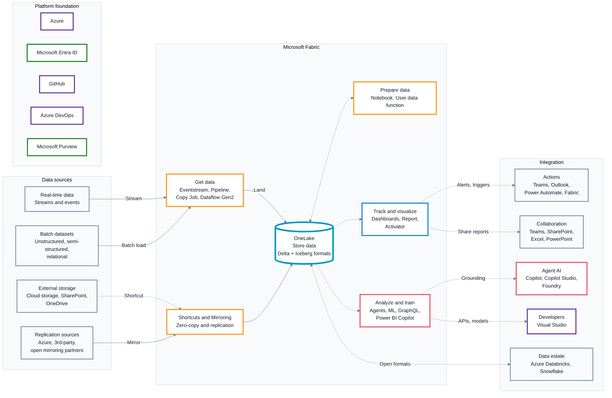
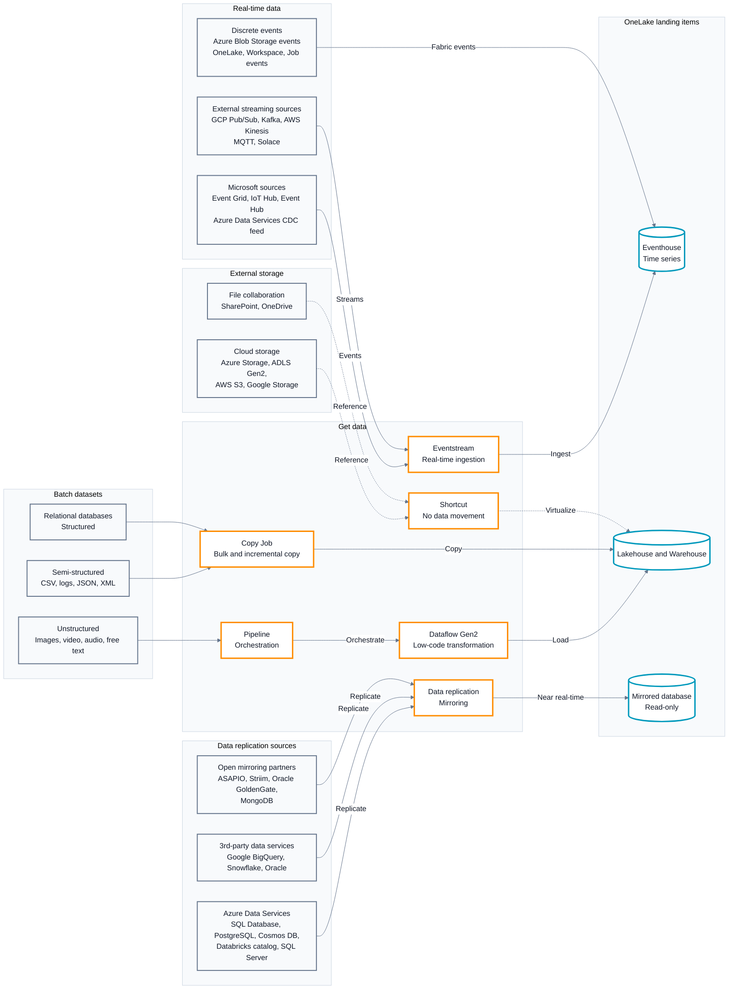
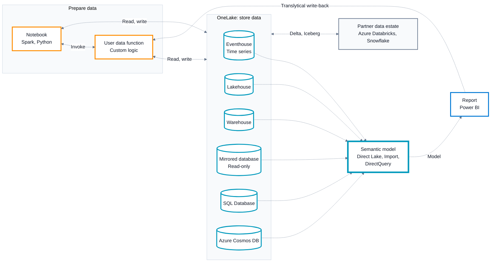
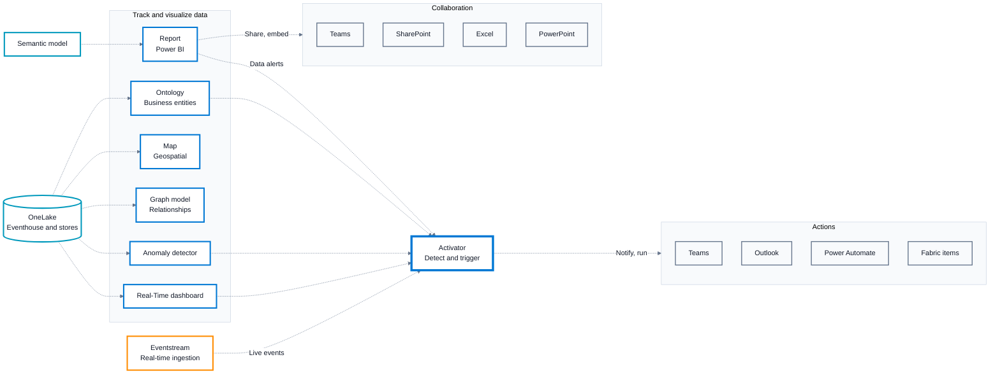
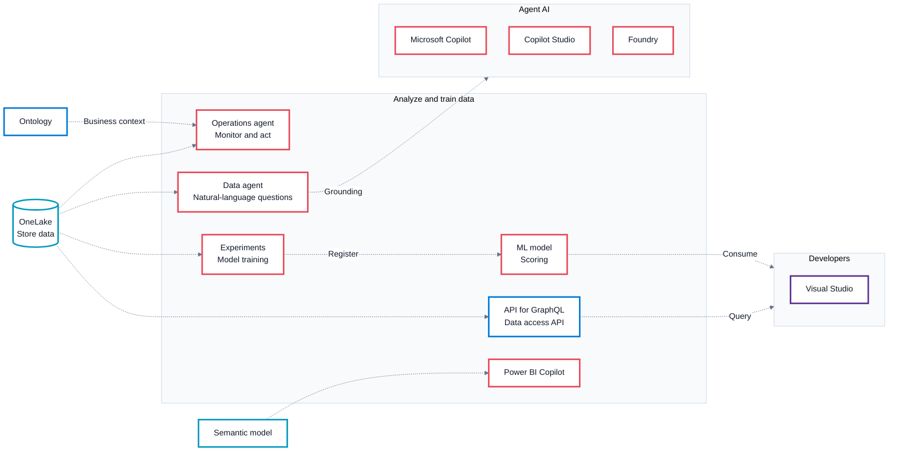

# Microsoft Fabric Architecture

The unified data platform for AI transformation: how data is ingested, stored in OneLake, prepared, visualized, acted on, analyzed and shared with the wider Microsoft ecosystem.

The source picture is too dense for one readable diagram, so it is presented as an overview followed by four focused drill-downs.

## Contents

1. [Platform overview](#1-platform-overview)
2. [Get data: sources and ingestion](#2-get-data-sources-and-ingestion)
3. [OneLake: store and prepare data](#3-onelake-store-and-prepare-data)
4. [Track, visualize and act](#4-track-visualize-and-act)
5. [Analyze, train and integrate](#5-analyze-train-and-integrate)

## Legend

| Line | Meaning |
| --- | --- |
| Solid arrow (`-->`) | Data movement or ingestion |
| Dashed arrow (`-.->`) | Data consumption (no data movement) |

| Border colour | Category |
| --- | --- |
| Slate `#64748B` | Sources and external systems |
| Orange `#FF8C00` | Ingestion and processing |
| Teal `#0099BC` | Data and storage |
| Blue `#0078D4` | Analytics, visuals and actions |
| Red `#E74856` | AI, agents and ML |
| Purple `#5C2D91` | Developer and DevOps tools |
| Green `#107C10` | Identity, security and governance |

A thicker border marks a primary component (OneLake, Semantic model, Activator).

## 1. Platform overview

**Microsoft Fabric: end-to-end overview**

Four families of source data enter Fabric through the Get data layer and land in OneLake. Every workload then consumes OneLake in place to track, visualize, analyze and train, and results flow out to Microsoft 365, agent, developer and partner tools. Azure, Entra ID, GitHub, Azure DevOps and Purview form the platform foundation.

- Only ingestion, mirroring and replication physically move data; shortcuts and every downstream workload read OneLake in place.
- OneLake supports any file type, structured or unstructured, stored in Delta and Iceberg-compatible formats, so partner engines such as Azure Databricks and Snowflake can share the same data.

## 2. Get data: sources and ingestion

**Sources and ingestion paths into OneLake**

Shows which Fabric ingestion item handles each kind of source: Eventstream for streams, Pipeline, Copy Job and Dataflow Gen2 for batch data, Shortcuts for external storage without moving data, and Mirroring for replicated databases.

- Eventstream also feeds Activator directly for real-time triggers (see diagram 4).
- Shortcuts expose Cloud storage and SharePoint/OneDrive content inside OneLake without copying it.

## 3. OneLake: store and prepare data

**OneLake storage items, semantic model and data preparation**

All Fabric storage items live in OneLake and are exposed to reporting through a semantic model using Direct Lake, Import or DirectQuery. Notebooks and User data functions prepare data in place, and Reports can write back through User data functions (translytical).

- The semantic model is the single business layer over every OneLake item; Direct Lake reads Delta tables without import.
- Translytical flow: a Report triggers a User data function that writes changes back to OneLake.

## 4. Track, visualize and act

**Real-time intelligence, reporting and Activator actions**

Visual and semantic items read OneLake in place and feed Activator, which turns detected conditions into actions in Teams, Outlook, Power Automate and Fabric. Reports are shared through Microsoft 365 collaboration tools.

- Activator is the hub for automated responses: it receives Eventstream data and signals from dashboards, Anomaly detector, Ontology and Report.
- The Ontology also grounds the Operations agent (see diagram 5).

## 5. Analyze, train and integrate

**AI, machine learning and developer integration**

Agents, experiments, ML models, the GraphQL API and Power BI Copilot all consume OneLake and the semantic model in place. Their outputs reach Copilot, Copilot Studio, Foundry and Visual Studio.

- The Data agent can be published to Copilot, Copilot Studio and Foundry as a grounded data source.
- ML models and the GraphQL API give developers programmatic access from Visual Studio.

---

*Diagrams render natively on GitHub. Exact appearance may vary slightly with GitHub's Mermaid version and light/dark theme.*
